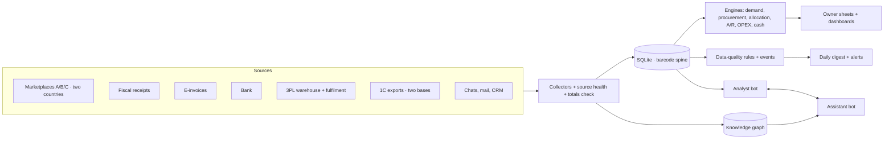
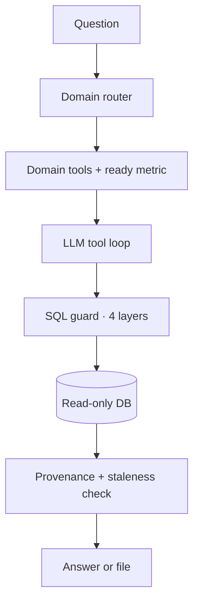

# Marketplace Control Tower

One system that pulls every source a distributor's business depends on into one database, reconciles the sources against each other, and turns them into decisions its owner can check. Built and run from inside the company by its analyst.

**since Jun 2026, active · Python · SQLite · code: private**
## The problem

A cosmetics distributor based in Uzbekistan sells through three marketplaces, wholesale buyers and retail chains, and no longer only at home: a sister company in Kazakhstan has its own accounting base, marketplace accounts and fulfilment warehouse, and marketplace orders are delivered to buyers in other CIS countries. Each country keeps its books in its own 1C base and its own currency. Goods sit at third-party warehouses, and every Uzbek sale also shows up as a fiscal receipt filed with the tax authority and as a national e-invoice. That makes many systems describing the same goods and money, and they disagree: documents get mirrored, cancelled and reissued, fees are withheld or invoiced separately, the same account arrives both as weekly files and through an API, and codes that look like product IDs aren't unique.

Before this system, reconciling them, forecasting demand and planning imports with long lead times meant spreadsheets and manual cross-checking. A wrong total looked exactly as convincing as a right one.

## What it does

- **Collects everything unattended**, three times a day: marketplace APIs in both countries, a warehouse portal and fulfilment stock reports, fiscal receipts, e-invoices, bank payments, mail and 1C exports. The second country's accounting base is loaded from full 1C exports. Every source reports its own health, and a file that doesn't match its own "Total" line is rejected instead of loaded.
- **Keeps countries and currencies apart**: figures in sums and in tenge live in separate tables and are never added into one total.
- **Reconciles money** across settlement reports, fiscal receipts, bank and ledger, per product and period, with evidence. A missing source shows as "no data", never as zero.
- **Forecasts demand** per product and channel from receipts and e-invoices, not marketplace estimates.
- **Plans procurement** against lead time, carton sizes, minimum orders and shelf life, which differs by channel.
- **Tracks receivables, OPEX, margin, credit risk and a 13-week cashflow** in owner reports with a freshness line on every sheet.
- **Answers questions in plain language** over Telegram or a web chat, using read-only SQL, with every number tagged by source and period.
- **Runs the owner's communications desk**: a second bot reads work chats, mail and the CRM, sorts what needs an answer, drafts replies in the owner's style, tracks promises in both directions and prepares notes before and after meetings. Nothing is sent without the owner's approval of the exact text.
- **Keeps a knowledge graph** of who owns what and what has already been decided, extracted from correspondence with a quoted source for every link, so the bots can check before asking a colleague something that was already answered.
- **Listens in on calls when asked**: a live copilot transcribes both sides and surfaces facts and open questions from read-only tools, in a window hidden from screen sharing.
- **Recommends, never acts**: procurement lines are firm, need review, or are blocked. The owner decides.

## How it works

Layers talk through the database schema, not Python imports. A table-ownership registry says who may write each table. Tables rebuilt from the network go through staging and an atomic swap, so a failed fetch never leaves a half-empty table. The code is split into modules (core, engines, knowledge, analyst, assistant) with fixed import directions; a test enforces them, and its list of old violations is only allowed to shrink. The two bots hand tasks to each other through a numbered task log instead of answering "no tool for that".

## Engineering notes

- **Barcode is the only product key.** The national product-type code looks like a key, but dozens of products share one. Records without a barcode are resolved by name and stay flagged as unresolved if the match isn't certain.
- **Unknown is not zero.** A missing cost parameter, carton size or payment term stays unknown and is labelled that way downstream, so it never turns into a plausible but invented number.
- **Two entities, two currencies, two copies of one stream.** The second country's data lives in its own tables and is never summed with the first. When one marketplace account arrives both as weekly report files and through its API, those are two sources of the same sales, documented as such, never added together.
- **Snapshots and registers are different things.** Most tables are append-only snapshots (read the latest one), but in-transit invoices are a register (read all open rows). Mixing the two up caused real bugs, and each case is now pinned by a named invariant and a regression test.
- **Guards refuse to publish broken numbers.** If total demand or stock inputs collapse against the previous run, the procurement step fails and the last valid plan stays on display.
- **Model choice by backtest.** A walk-forward harness compared forecast variants on history. Exponential smoothing replaced the old method for one marketplace channel (cumulative 3-month WAPE 0.42 → 0.37 on the top class). Wholesale kept a robust median, because no variant beat it.
- **An LLM that cannot write.** SQL runs through four independent layers: a read-only connection, a statement authorizer that allows only reads, validation, and a runtime deadline; questions arriving from a colleague's chat are further limited to an allowlist of tables. File contents sent to the bot are wrapped as data, not instructions. In the assistant, the parts that read and draft cannot import anything that sends: a single deterministic sender delivers only approved text, and only to the original thread.
- **Built with coding agents on purpose.** Claude Code and Codex work in fixed roles (implementer, fresh-context reviewer, read-only auditor), one task per branch and worktree, with hooks that block destructive commands in the live copy. The human work was specifying invariants and auditing the results, recorded in a decision log of 250+ numbered entries.

## How it is verified

- **One-command gate**: compile, lint, secret scan, type check, 4,700+ tests and a coverage floor (75.9 % branch coverage at the last baseline). A parallel run must execute exactly as many tests as a serial one would find.
- **Local gate as the merge condition**: a full green run on a clean tree marks the commit, and nothing is merged into the main branch without that mark on the exact head.
- **Full-cycle regression**: every engine runs on a copy of the live database, and key metrics are diffed against their history. Any shift over 2 % must be explained.
- **Golden questions for the bots**: a contract suite runs on a fixture database with planted stale-snapshot traps. A nightly judge checks live answers against canonical metrics for the named period, with a separate LLM review and a check on attached files. The assistant's routing and the knowledge graph have their own labelled eval sets built from real failures.
- **Independent adversarial audits** by read-only agents, working from written charters. Findings are verified before anything is fixed.
- **Refactoring baselines**: the offline engine chain went from 19 s to 1 s with a zero metric diff.

## Stack

Python 3.14, SQLite (WAL), pandas, openpyxl, pdfplumber, Playwright, stdlib `http.server` dashboards, Google Sheets API, Telegram Bot API, OpenAI and Anthropic model APIs, Claude, Codex and Gemini CLIs, a cloud speech-to-text API with Windows audio capture, 1C, Didox e-invoicing, the national e-signature client, Windows Task Scheduler, PowerShell, pytest/unittest, ruff, mypy.

## Access

The code is private because it runs a live business. To request a walkthrough or read access, open an issue in this repository or email eazamat360@gmail.com.
